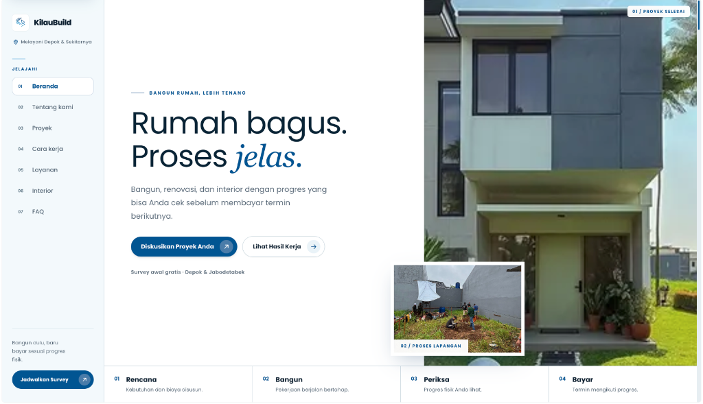

<div align="center">

  

  # KilauBuild
  ### *Platform Digital Kontraktor Bangunan, Arsitektur & Desain Interior*
  
  **"Bangun Dulu Baru Bayar — Wujudkan Rumah Impian Tanpa Rasa Cemas"**

  [](https://nextjs.org/)
  [](https://nestjs.org/)
  [](https://www.prisma.io/)
  [](https://neon.tech/)
  [](https://tailwindcss.com/)
  [](https://www.typescriptlang.org/)

</div>

---

## 🌐 Live Demo & Akses CMS Admin di Vercel

Aplikasi web KilauBuild dapat diakses dan diuji coba secara langsung melalui tautan resmi:

* **Website Publik**: [https://kilau-build.vercel.app](https://kilau-build.vercel.app)
* **Portal Login CMS Admin**: [https://kilau-build.vercel.app/admin/login](https://kilau-build.vercel.app/admin/login)
  * **Email Admin**: `admin@kilaubuild.com`
  * **Password**: `Password123!`
  * **Aturan Keamanan Password**: Wajib minimal 8 karakter, kombinasi huruf besar (A-Z), huruf kecil (a-z), angka (0-9), dan simbol unik (`!@#$%^&*`).
  * **Fitur Uji Coba Demo**: Dilengkapi *Smart Local Storage Fallback*, memungkinkan penguji mencoba fitur dashboard (manajemen proyek, katalog interior, jadwal survey, pesan klien, testimoni, FAQ) secara interaktif langsung dari browser.

---

## 🖼️ Tampilan Hero Section (Pratinjau Halaman Utama)

Di bawah ini adalah gambaran visual **Hero Section** saat pengguna pertama kali membuka website KilauBuild:

<div align="center">
  
</div>

<br />

> ### *"Rumah bagus. Proses jelas. Bangun rumah, lebih tenang."*
> *Bangun, renovasi, dan tata interior dengan progres yang bisa Anda cek langsung di lokasi sebelum membayar termin berikutnya.*

### 🔄 4 Langkah Mudah Membangun Bersama KilauBuild:
1. **`01 / Rencana`** — Kebutuhan ruang, desain denah, dan rincian biaya (RAB) disusun secara transparan.
2. **`02 / Bangun`** — Konstruksi dijalankan oleh tenaga ahli dan tukang berpengalaman sesuai jadwal kerja.
3. **`03 / Periksa`** — Klien mengecek langsung hasil fisik pekerjaan di lapangan pada setiap tahapan.
4. **`04 / Bayar`** — Pembayaran termin ditransfer hanya jika progres pekerjaan sudah terbukti selesai dan terverifikasi.

---

## 💡 Apa Itu Project KilauBuild?

**KilauBuild** adalah platform web terintegrasi yang dirancang khusus untuk menjembatani pemilik properti (klien) dengan jasa konstruksi & desain interior profesional yang berbasis di **Depok dan wilayah Jabodetabek**.

### ❗ Masalah yang Sering Dialami Pemilik Rumah:
* **Takut Kontraktor Nakal**: Banyak pemilik rumah trauma karena kontraktor meminta uang muka (DP) besar di awal lalu kabur atau mengabaikan proyek.
* **Proyek Mangkrak & Terbengkalai**: Alur kerja tidak terstruktur menyebabkan pembangunan tertunda berbulan-bulan.
* **RAB Membengkak**: Muncul biaya siluman yang tidak dijelaskan secara rinci di awal kerja sama.
* **Kualitas Tak Sesuai Janji**: Material dan hasil akhir yang dipasang berbeda dari rencana atau contoh 3D.

### ✅ Solusi yang Diberikan KilauBuild:
KilauBuild membalikkan pola konvensional tersebut dengan prinsip **"Bangun Dulu Baru Bayar"**:
* **Pembayaran Bertahap Berbasis Termin**: Klien tidak ditagih sebelum pekerjaan pada termin bersangkutan benar-benar terpasang di lokasi proyek.
* **Survey Lokasi & Estimasi 100% Gratis**: Tim estimator datang langsung ke lokasi lahan/rumah untuk mengukur dan memberikan simulasi biaya tanpa biaya komitmen di muka.
* **Foto & Bukti Proyek Nyata**: Seluruh portofolio yang ditampilkan adalah hasil dokumentasi fisik di lapangan, bukan sekadar render grafis yang tidak realistis.

---

## 🛠️ Layanan Utama KilauBuild

| Layanan | Deskripsi Pekerjaan |
| :--- | :--- |
| 🏠 **Bangun Rumah Baru dari 0** | Konstruksi bangunan lengkap: pengukuran lahan, galian pondasi cakar ayam/batu kali, struktur beton bertulang, pasangan bata, atap baja ringan, hingga instalasi MEP dan cat finishing. |
| 🔨 **Renovasi Rumah & Fasad** | Renovasi total maupun sebagian: penambahan lantai 2 (dak cor beton), pembongkaran dinding sekat, peremajaan tampak depan (fasad modern minimalis), dan penggantian atap. |
| 🛋️ **Desain Interior & Custom Furniture** | Pembuatan furniture kustom presisi tinggi: kitchen set HPL/duco, backdrop TV estetik, lemari pakaian built-in, partisi ruang kisi-kisi kayu, dan pencahayaan aksen *warm white*. |
| 📐 **Konsultasi & Survey Lapangan** | Kunjungan langsung tim arsitek dan estimator ke lokasi Anda di Depok dan seluruh Jabodetabek untuk konsultasi teknis, pengukuran tanah, dan penyusunan RAB detail. |

---

## 🌟 Fitur Platform yang Tersedia

### 1. Bagi Pengunjung & Calon Klien (Website Publik)
* **Visual Hero Section**: Pengenalan cepat atas nilai garansi, keunggulan termin, dan alur tahapan kerja.
* **Galeri Portofolio Proyek**: Eksplorasi dokumentasi foto proyek selesai berdasarkan kategori (*Bangun Baru*, *Renovasi*, *Interior*).
* **Transparansi Proyek Berjalan (*On-Going*)**: Memantau dokumentasi foto tahapan konstruksi yang sedang aktif di lapangan.
* **Formulir Booking Survey Online**: Fitur kalender interaktif untuk memilih tanggal kunjungan survey lokasi, lengkap dengan nama, nomor telepon, alamat, dan jenis proyek.
* **Integrasi Konsultasi WhatsApp Cepat**: Tombol *floating* dan *call-to-action* langsung ke WhatsApp resmi KilauBuild untuk respon instan.
* **Pusat Informasi & FAQ**: Jawaban transparan mengenai garansi konstruksi, perhitungan RAB, mekanisme termin, dan spesifikasi material bangunan.

### 2. Bagi Tim Operasional & Manajemen (Panel Internal CMS)
* **Dashboard Metrik**: Ringkasan data jumlah proyek selesai, proyek berjalan, jumlah ulasan, dan pesan survey yang masuk.
* **Manajemen Portofolio**: Modul untuk menambah, mengubah, dan menghapus proyek beserta foto dokumentasi aslinya.
* **Manajemen Testimoni**: Mengelola ulasan kepuasan klien dan rating bintang.
* **Manajemen FAQ**: Menyesuaikan pertanyaan umum sesuai kebutuhan operasional terkini.
* **Manajemen Booking & Kontak Masuk**: Memantau daftar pengajuan survey lapangan dari calon klien untuk segera ditindaklanjuti.
* **Keamanan Akses CMS**: Dilindungi dengan autentikasi berbasis JWT (JSON Web Token) dan enkripsi password *bcrypt*.

---

## 💻 Arsitektur Teknis & Tech Stack

Platform ini dibangun dengan arsitektur **Modular Monolith** yang memisahkan frontend dan backend secara bersih dalam satu repository:

```text
pjbl/
├── backend/            # REST API Server berbasis NestJS 12
│   ├── prisma/         # Skema database & seeder data awal
│   └── src/modules/    # Modul API (auth, projects, testimonies, faqs, contacts)
├── frontend/           # Aplikasi Web berbasis Next.js 16 (App Router)
│   ├── src/app/        # Rute publik & rute internal admin (/admin)
│   ├── src/components/ # Komponen UI reaktif (Hero, Portfolio, Booking, dll.)
│   └── public/         # Asset visual otentik, foto proyek, dan logo
└── docs/               # Dokumentasi spesifikasi (PRD, SCHEMA, API_SPEC, DESIGN_SYSTEM)
```

### Daftar Teknologi:
* **Frontend**: Next.js 16, React 19, Tailwind CSS v4, Font Poppins & Georgia Serif, Motion (Framer Motion v14), Lucide React & Phosphor Icons.
* **Backend**: NestJS 12, Express, Prisma ORM 6, Swagger OpenAPI, Passport JWT, Bcrypt, Helmet, Throttler Rate Limiter.
* **Database**: Neon Serverless PostgreSQL (Singapore Region `ap-southeast-1`).
* **Deployment**: Dirancang untuk deployment terpisah ke **Vercel** (sebagai project API dan project Web).

---

## ⚡ Panduan Menjalankan Project di Komputer Lokal

Bagi pengembang atau tim teknis yang ingin menjalankan project ini di komputer lokal:

### 1. Jalankan Backend (REST API)
```bash
cd backend
npm install
cp .env.example .env

# Jalankan migrasi & seeder data awal (admin default, portofolio, faqs)
npm run db:push
npm run db:seed

# Mulai server backend
npm run start:dev
```
* Backend aktif di: `http://localhost:3000`
* Dokumentasi API Swagger interaktif: `http://localhost:3000/api/docs`

### 2. Jalankan Frontend (Next.js)
Buka jendela terminal baru:
```bash
cd frontend
npm install
cp .env.example .env.local

# Mulai server frontend Next.js (port 3001 otomatis)
npm run dev
```
* Website publik terbuka di browser: `http://localhost:3001`
* Halaman login CMS Admin: `http://localhost:3001/admin/login`
  * **Akun Demo / Percobaan Lokal (Hasil Seeder Dummy — BUKAN Database Asli)**:
    * **Email**: `admin@kilaubuild.com`
    * **Password**: `Password123!`

> ⚠️ **Catatan Penting (Hanya untuk Uji Coba)**: Akun dan data di atas hanyalah data **dummy / simulasi percobaan** yang dibuat otomatis oleh script seeder lokal (`backend/prisma/seed.ts`) untuk kemudahan pengujian fitur di komputer lokal pengembang. Ini **BUKAN** database produksi asli.

---

## 📍 Kontak Resmi KilauBuild

* **Area Layanan**: Depok, Jakarta, Bogor, Tangerang, Bekasi (Jabodetabek)
* **WhatsApp**: `+62 877-7636-0795`
* **Email**: `kilaubuild@gmail.com`
* **Instagram**: `@kilaubuild`

---

## 📄 Dokumen Spesifikasi Tambahan
* [Product Requirements Document (PRD)](docs/PRD.md)
* [Database Schema & Dictionary](docs/SCHEMA.md)
* [API Specification Reference](docs/API_SPEC.md)
* [Design System & Brand Tokens](docs/DESIGN_SYSTEM.md)
* [Vercel Deployment Guide](DEPLOY_VERCEL.md)
* [Developer Guidelines (AGENTS.md)](AGENTS.md)

---
*Hak Cipta © 2026 KilauBuild. Seluruh hak cipta dilindungi.*
